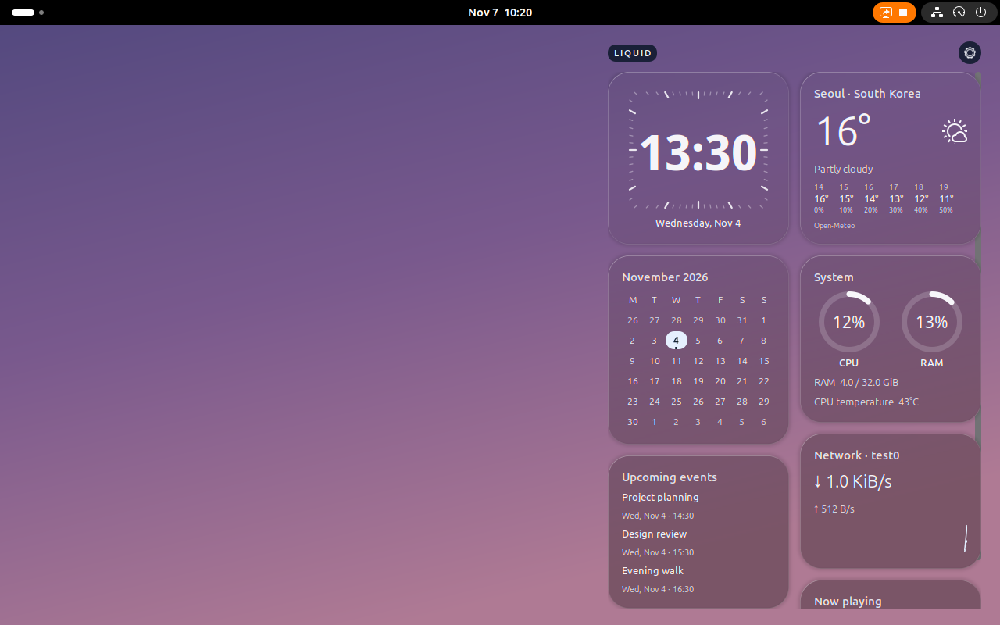
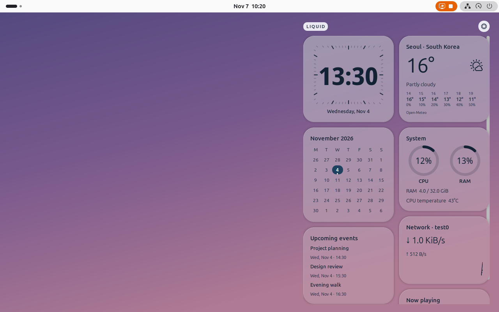

# Liquid Widgets

[](#compatibility)
[](#compatibility)
[](LICENSE)
[](https://github.com/NyongCho/gnome-widget/releases/latest)

Liquid glass desktop widgets for GNOME Shell. Keep your clock, calendar, weather, system stats, network activity, and music on the desktop, with wallpaper blur and refraction that follow your background.

[Features](#features) · [Installation](#installation) · [Configuration](#configuration) · [Development](#development) · [Report an issue](https://github.com/NyongCho/gnome-widget/issues)



*Captured in GNOME Shell with the English interface and sample data. Widgets and preferences support English and Korean.*

<details>
<summary>View the light theme</summary>



</details>

## Features

| Widget | What it shows |
| --- | --- |
| **Clock** | Time and date with four faces: large digital, square dial, classic analog, and minimal analog. |
| **Calendar** | A monthly calendar with today's date highlighted. Click to open Google Calendar in your browser. |
| **Upcoming events** | Read-only events from a Google Calendar iCal feed. |
| **Weather** | Current conditions and a six-hour temperature and precipitation forecast from Open-Meteo. |
| **System** | CPU and memory donut gauges, plus CPU temperature when a supported sensor is available. |
| **Network** | Upload and download rates for the automatic or selected network interface. |
| **Now playing** | Track information and artwork from MPRIS-compatible players, with the artwork's aspect ratio preserved. |

Make the layout your own:

- Move widgets between independent left and right columns, reorder them, or hide individual cards.
- Choose a monitor and desktop corner, then adjust the size and margins.
- Tune glass tint and refraction, or use low-power mode.
- Follow GNOME's light or dark appearance and respond to wallpaper changes.
- Switch between English and Korean in preferences.

## Compatibility

- **GNOME Shell 50 on Wayland.** Tested on Ubuntu 26.04.1 with GNOME Shell 50.1. Other major Shell versions are not currently supported.
- GJS, GTK 4, libadwaita, and libsoup 3 with their GObject Introspection bindings must be available in your desktop environment.
- Google Calendar integration also requires libsecret and a session Secret Service, such as GNOME Keyring.

The public edition runs with GNOME's GJS runtime. Rust, Node.js, npm, and a separate systemd service are not needed to run an installed public ZIP. Node.js and npm are used when building from source.

## Installation

> [!NOTE]
> Liquid Widgets is available through GitHub Releases. It is not yet listed on extensions.gnome.org.

### Install from GitHub Releases

Download **[liquid-widgets.shell-extension.zip](https://github.com/NyongCho/gnome-widget/releases/latest/download/liquid-widgets.shell-extension.zip)** from the [latest release](https://github.com/NyongCho/gnome-widget/releases/latest). Open a terminal in the folder where you saved it and run:

```sh
gnome-extensions install --force liquid-widgets.shell-extension.zip
```

**Log out and log back in** so GNOME Shell can load the new extension. Then enable it and open preferences:

```sh
gnome-extensions enable liquid-widgets@nyongcho.github.io
gnome-extensions prefs liquid-widgets@nyongcho.github.io
```

You can also open preferences through GNOME Extensions or the gear button above the widgets.

To verify the download, save [SHA256SUMS](https://github.com/NyongCho/gnome-widget/releases/latest/download/SHA256SUMS) alongside the ZIP and run `sha256sum -c SHA256SUMS`. For updates, install the ZIP from a newer release and log out and back in.

### Build from source

To build the latest development version, install **Git**, **Python 3**, **Node.js 24 or newer**, **npm**, and **`glib-compile-schemas`**, in addition to the GNOME components listed above. Then run:

```sh
git clone https://github.com/NyongCho/gnome-widget.git
cd gnome-widget

./scripts/dev npm --prefix extension ci
python3 scripts/package.py --edition gjs
gnome-extensions install --force dist/liquid-widgets-public/liquid-widgets.shell-extension.zip
```

The generated ZIP includes the project license and third-party notices. Log out and back in, then enable the extension as described above. For later source updates, run `git pull` and repeat the build and install commands.

## Configuration

Preferences have two tabs: **Widgets** and **Data**.

| Setting | Where to find it |
| --- | --- |
| Language | **Widgets → Language**. Select English or Korean; Korean is the initial default. |
| Layout | **Widgets → Left column / Right column**. Move cards between columns and change their order. |
| Clock and appearance | **Widgets**. Choose a clock face, adjust the glass effect, or enable low-power mode. |
| Weather location | **Data → Weather location**. Search for a city and select it. |
| Google Calendar | **Data → Google Calendar**. Connect your calendar's secret iCal address. |
| Network interface | **Data → Network**. Use automatic selection or choose an interface. |

To get the calendar address, open Google Calendar in your browser, select the calendar in **Settings**, and find **Integrate calendar → Secret address in iCal format**. Paste it directly into the extension's preferences. The address is stored in your desktop keyring. Calendar and event cards open Google Calendar in your default browser; the extension does not edit events.

The music card appears only while a compatible MPRIS player is playing. It displays metadata and artwork; it does not provide playback controls.

### Uninstall

To remove saved calendar credentials, disconnect the calendar in preferences and finish any pending credential deletion **before** uninstalling.

```sh
gnome-extensions disable liquid-widgets@nyongcho.github.io
gnome-extensions uninstall liquid-widgets@nyongcho.github.io
```

Uninstalling the extension leaves settings and caches in place. See the [setup guide](docs/setup.md) for storage locations and complete cleanup instructions.

## Development

After installing the build dependencies and running `npm ci` as above:

```sh
# Check the public TypeScript/GJS edition.
./scripts/check.sh --edition gjs

# Build the public extension ZIP.
python3 scripts/package.py --edition gjs
```

The repository contains two editions with shared widgets, preferences, and GLSL shaders:

| Edition | Data backend | Extension UUID |
| --- | --- | --- |
| **Public** | TypeScript/GJS, with a short-lived calendar calculation worker | `liquid-widgets@nyongcho.github.io` |
| **Personal Rust** | Rust user service with libical | `liquid-widgets@local` |

The editions keep separate settings, caches, and keyring entries. Disable the other edition when switching to avoid duplicate widgets; settings are not migrated automatically.

<details>
<summary>Building the personal Rust edition</summary>

This edition additionally needs Rust, a C compiler, pkg-config, and libical development files. Its installed runtime uses libical and a user systemd service.

```sh
./scripts/check.sh --edition rust
python3 scripts/package.py --edition rust
```

The distribution is written to `dist/liquid-widgets/`. See the [setup guide](docs/setup.md) for installation and switching between editions.

Use `./scripts/check.sh --edition all` to check both editions. Always pass `--edition gjs` when packaging the public extension: the packaging command defaults to Rust for compatibility with the personal edition.

</details>

### Documentation

- [Architecture and data services](docs/data-service.md)
- [Public edition UI verification](docs/public-edition-verification.md)
- [Performance and lifecycle measurements](docs/typescript-performance.md)
- [GNOME Extensions release preparation](docs/gnome-extensions-release.md)
- User guides, currently in Korean: [setup and removal](docs/setup.md), [Google Calendar](docs/calendar.md), [weather](docs/weather.md), and [system, network, and media](docs/live-data.md).

## Contributing

Bug reports, translations, and pull requests are welcome. Before opening an [issue](https://github.com/NyongCho/gnome-widget/issues), check for an existing report and include:

- Your distribution and GNOME Shell version.
- The edition you installed and the commit you built.
- Steps to reproduce the problem, with relevant logs or screenshots.

Keep secret calendar URLs and private event details out of reports. For code changes, run the checks for the edition you changed; changes to shared code should be checked in both editions.

## License

Original project code is licensed under **GNU GPL version 3 or, at your option, any later version** ([GPL-3.0-or-later](LICENSE)).

Bundled third-party code and data retain their own licenses. See [Third-party notices](THIRD_PARTY_NOTICES.md) for ical.js, timezone data, and other dependencies. Weather data is provided by [Open-Meteo](https://open-meteo.com/), with location data from GeoNames.
